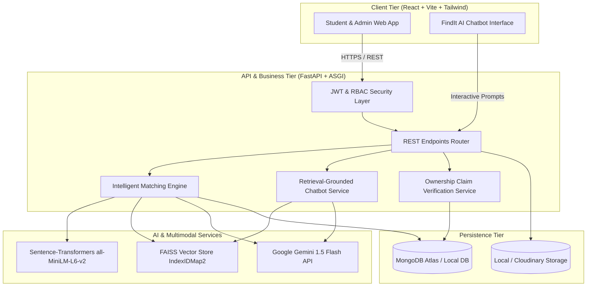

# FindIt AI — Smart Campus Lost & Found Management System

FindIt AI is an intelligent, full-stack, Generative AI–powered Lost and Found platform specifically architected for college campuses. It replaces ineffective bulletin boards and simplistic keyword-based databases with a multimodal AI pipeline: combining Google Gemini vision understanding, Sentence Transformer semantic embeddings, FAISS vector search, and a calibrated multi-attribute matching formula.

---

## Table of Contents
1. [Project Overview & Problem Statement](#project-overview--problem-statement)
2. [Key Objectives & Capabilities](#key-objectives--capabilities)
3. [Technology Stack](#technology-stack)
4. [System Architecture](#system-architecture)
5. [Generative AI & Matching Pipeline](#generative-ai--matching-pipeline)
   - [Multimodal Image Understanding (Gemini)](#1-multimodal-image-understanding-gemini)
   - [Semantic Embeddings & Vector Search (FAISS)](#2-semantic-embeddings--vector-search-faiss)
   - [Multi-Attribute Matching Formula & Mathematical Derivation](#3-multi-attribute-matching-formula--mathematical-derivation)
   - [Explainable AI Match Summaries](#4-explainable-ai-match-summaries)
   - [Retrieval-Grounded AI Assistant (FindIt Chatbot)](#5-retrieval-grounded-ai-assistant-findit-chatbot)
6. [Database Schema (MongoDB)](#database-schema-mongodb)
7. [Repository Folder Structure](#repository-folder-structure)
8. [Installation & Setup Guide](#installation--setup-guide)
9. [Running the Application](#running-the-application)
10. [Running Automated Tests](#running-automated-tests)
11. [REST API Documentation](#rest-api-documentation)
12. [Deployment with Docker & Docker Compose](#deployment-with-docker--docker-compose)
13. [Security, Privacy & Ethics](#security-privacy--ethics)
14. [Limitations & Future Roadmap](#limitations--future-roadmap)

---

## Project Overview & Problem Statement

On university campuses, thousands of items (water bottles, laptops, earbuds, IDs, calculators, bags, umbrellas, and keys) are misplaced each semester. Existing systems fail because:
1. **Vocabulary Mismatch**: A student reports losing a *"black insulated water bottle near the library"*, while the finder logs a *"dark steel thermos found outside central library"*. Exact keyword searches produce zero hits.
2. **Missing Identifiers**: Finders often do not know brand names or object specifics.
3. **Manual Overhead**: Campus security offices spend hours manually inspecting notebooks and fielding repetitive inquiries.
4. **Fraud & Verification Risks**: Without a secure, private verification protocol, public listings expose distinguishing features, enabling fraudulent claims.

**FindIt AI** resolves these challenges by bridging multimodal perception, semantic vector similarity, weighted attribute evidence, and human-in-the-loop administrative verification.

---

## Key Objectives & Capabilities

- **Multimodal Item Reporting**: Students upload photos; Gemini identifies the item, infers category, detects visible colors and materials, and generates objective descriptions.
- **Editable AI Suggestions**: Users review and refine AI suggestions prior to database persistence.
- **Bi-Directional Automated Matching**: Newly submitted lost items search candidate found items, and newly submitted found items search candidate lost items.
- **Explainable Match Scores**: Transparent 0–100 match ratings accompanied by natural-language explanations grounded only in verified attribute evidence.
- **Campus Location Normalization**: Resolves campus colloquialisms (e.g., *"Main Library"*, *"Central Library"*, *"Library 2nd Floor"*) to canonical campus zones.
- **Secure Two-Step Claim Verification**: Distinguishing traits remain private; claimants answer ownership verification questions, reviewed by administrators.
- **Privacy-First Conversational Assistant**: Grounded in campus records without hallucinatory matches and strictly redactions for student contact details.
- **Real-Time Admin Dashboard**: Live MongoDB aggregations tracking recovery rates, time-to-recovery, category breakdowns, and audit trails.

---

## Technology Stack

| Layer | Technologies |
|---|---|
| **Frontend** | React 18, Vite, TypeScript, Tailwind CSS, React Router v6, Axios, Lucide React, Recharts |
| **Backend** | Python 3.11+, FastAPI, Pydantic v2, Motor (Async MongoDB), PyMongo, Uvicorn, Python-Jose (JWT), Passlib / Bcrypt |
| **Database** | MongoDB (Primary persistence, aggregations, compound indexing) |
| **Generative AI** | Google Gemini 1.5 Flash (`google-generativeai` SDK) |
| **Embeddings & Vector Search** | Sentence Transformers (`all-MiniLM-L6-v2`), FAISS (`IndexIDMap2` / `IndexFlatIP`) with fallback |
| **Testing** | Pytest, Pytest-Asyncio, HTTPX / FastAPI TestClient |
| **Containerization** | Docker, Docker Compose, Multi-stage builds, Nginx reverse proxy |

---

## System Architecture



---

## Generative AI & Matching Pipeline

### 1. Multimodal Image Understanding (Gemini)
When a photograph is uploaded during report submission:
- The image bytes are inspected and validated against strict MIME types and file size boundaries.
- The image is provided to Google Gemini 1.5 Flash alongside user notes.
- The model outputs structured JSON with fields: `object_name`, `category`, `color`, `brand`, `visible_features`, `estimated_object_type`, `confidence`, and `description`.
- A Pydantic schema (`AIExtractedAttributes`) validates the payload, guarding against malformed JSON or hallucinations before user confirmation.

### 2. Semantic Embeddings & Vector Search (FAISS)
1. **Pre-processing**: Attributes (`title`, `description`, `category`, `color`, `location`, `visible_features`) are normalized into a unified searchable text representation.
2. **Dense Representation**: `all-MiniLM-L6-v2` produces a 384-dimensional unit vector ($\|\vec{v}\| = 1$).
3. **FAISS Indexing**: Vectors are indexed using `faiss.IndexFlatIP` mapped via `faiss.IndexIDMap2` using integer identifiers mapped to MongoDB `ObjectId`s.
4. **State Resilience**: MongoDB remains the single source of truth. Upon application reboot, the vector store automatically rebuilds from active records.

### 3. Multi-Attribute Matching Formula & Mathematical Derivation
The final match score between a Lost item ($L$) and a Found item ($F$) is calculated as a normalized, weighted linear combination:

$$\text{Final Score} = \left( \frac{\sum_{i=1}^{n} w_i \cdot S_i}{\sum_{i=1}^{n} w_i} \right) \times 100$$

| Attribute ($i$) | Weight ($w_i$) | Component ($S_i$) Scoring Criteria |
|---|---|---|
| **Semantic Similarity** | $0.30$ | Cosine inner product: $\vec{v}_L \cdot \vec{v}_F \in [0.0, 1.0]$ |
| **Category Match** | $0.20$ | $1.0$ (exact), $0.75$ (hierarchical synonym family), $0.0$ (disjoint) |
| **Color Similarity** | $0.15$ | Jaccard index over normalized color sets: $\frac{\|C_L \cap C_F\|}{\|C_L \cup C_F\|}$ |
| **Brand Similarity** | $0.10$ | $1.0$ (exact match), $0.8$ (substring), $0.0$ (explicit mismatch) |
| **Location Proximity** | $0.15$ | Campus Taxonomy: $1.0$ (canonical zone match), $0.75$ (adjacent zone), $0.1$ (different campus zone) |
| **Temporal Proximity** | $0.10$ | Exponential time-decay: $S_{\text{temp}} = \exp\left(-\frac{\max(0, \Delta t)}{7.0}\right)$ where $\Delta t = t_{\text{found}} - t_{\text{lost}}$ in days |

**Handling Missing Attributes**:
When an optional attribute (e.g., brand) is unrecorded, it is treated neutrally ($0.5$ base score) rather than penalizing legitimate matches, maintaining fair ranking.

**Ranking Tiers**:
- **80 – 100%**: High Potential Match (triggers automatic in-app alerts to both users)
- **60 – 79%**: Possible Candidate Match (surfaced in candidate matches tab)
- **< 60%**: Low Confidence (filtered out to avoid notification fatigue)

### 4. Explainable AI Match Summaries
When shortlisted candidates are detected, Gemini evaluates the factual attributes of both items to craft an objective explanation for users and campus admins:
> *"Both reports describe a black insulated reusable flask. The reported locations map to the Central Library complex, and the dates are within 24 hours. Verification is recommended."*

### 5. Retrieval-Grounded AI Assistant (FindIt Chatbot)
The conversational chatbot implements a strict **RAG (Retrieval-Augmented Generation)** pattern:
1. User input is embedded and queried against the FAISS vector index.
2. Active matching items are retrieved from MongoDB and sanitized (all phone numbers, emails, and private claim proof answers are omitted).
3. The prompt instructs Gemini to formulate its answer **exclusively** from the retrieved campus items. If no matches exist, it instructs the student on filing a report, preventing hallucinations.

---

## Database Schema (MongoDB)

```
Database: findit_ai
├── users
│   ├── _id (ObjectId), name, email, password_hash, role, department, student_id, is_active, created_at
├── lost_items
│   ├── _id, user_id, title, description, category, brand, color, identifying_features, approximate_date_lost, location_lost, image_urls, ai_extracted_attributes, status, created_at, updated_at
├── found_items
│   ├── _id, user_id, title, description, category, brand, color, identifying_features, date_found, location_found, storage_location, image_urls, ai_extracted_attributes, status, created_at, updated_at
├── matches
│   ├── _id, lost_item_id, found_item_id, semantic_score, category_score, color_score, brand_score, location_score, temporal_score, final_score, match_explanation, match_status, created_at
├── claims
│   ├── _id, lost_item_id, found_item_id, claimant_user_id, proof_description, proof_answers, status, admin_feedback, created_at, reviewed_at
├── notifications
│   ├── _id, user_id, title, message, notification_type, related_item_id, is_read, created_at
├── audit_logs
│   ├── _id, actor_user_id, action, entity_type, entity_id, details, created_at
└── conversations
    ├── _id, user_id, messages, created_at, updated_at
```

---

## Repository Folder Structure

```
lost nd found/
├── docker-compose.yml          # Container orchestration (MongoDB, Backend, Frontend)
├── .env.example                # Canonical environment template
├── README.md                   # Complete architectural and operational guide
├── backend/
│   ├── Dockerfile              # Backend containerization
│   ├── requirements.txt        # Python package definitions
│   ├── uploads/                # Local file storage directory
│   ├── tests/                  # Pytest test suite
│   │   ├── conftest.py         # Test fixtures & mocks
│   │   ├── test_auth.py        # Authentication & JWT tests
│   │   ├── test_items.py       # Item reporting & authorization tests
│   │   ├── test_similarity.py  # Mathematical matching formula tests
│   │   ├── test_claims_and_admin.py # Claim lifecycle & audit tests
│   │   └── test_ai_and_chat.py # Multimodal parsing & chatbot RAG tests
│   └── app/
│       ├── main.py             # FastAPI entry point, lifespan, CORS, static routes
│       ├── core/               # Configuration, security, dependencies
│       ├── database/           # MongoDB client connection and index management
│       ├── models/             # Pydantic domain models for all 7 collections
│       ├── schemas/            # Request/response validation schemas
│       ├── routers/            # Auth, Items, Matching, AI, Claims, Admin endpoints
│       ├── services/           # Gemini, Embeddings, FAISS, Matching, Claims, Analytics
│       └── utils/              # Text normalization, location taxonomy, response helpers
└── frontend/
    ├── Dockerfile              # Multi-stage production container
    ├── nginx.conf              # SPA routing and API reverse proxy
    ├── package.json            # React & Vite dependencies
    ├── tsconfig.json           # TypeScript configuration
    ├── tailwind.config.js      # Custom theme colors and layout
    └── src/
        ├── App.tsx             # Root router with role-based Route Guards
        ├── main.tsx            # DOM bootstrapping
        ├── components/         # Modals, Navbar, Footer, ItemCard, Dropzone
        ├── pages/              # Landing, Auth, Dashboards, Listings, Reports, Chatbot
        ├── services/           # Axios API connectors
        ├── context/            # Authentication & Notification providers
        └── types/              # TypeScript definitions for items, matches, claims
```

---

## Installation & Setup Guide

### Prerequisites
- Node.js 18+ and npm
- Python 3.11+
- MongoDB installed locally or a free MongoDB Atlas connection string
- (Optional) Google Gemini API Key from Google AI Studio

### Step 1: Clone and Configure Environment
```bash
git clone <repository_url>
cd "lost nd found"

# Copy environment template
cp .env.example backend/.env
```

Edit `backend/.env` with your settings:
```ini
MONGODB_URI=mongodb://127.0.0.1:27017
DATABASE_NAME=findit_ai
GEMINI_API_KEY=your_actual_gemini_api_key
JWT_SECRET_KEY=use_a_secure_random_string_here
```

### Step 2: Backend Setup
```bash
# Create and activate Python virtual environment
python -m venv .venv

# Windows:
.\.venv\Scripts\activate
# Linux/macOS:
source .venv/bin/activate

# Install dependencies
pip install -r backend/requirements.txt
```

### Step 3: Frontend Setup
```bash
cd frontend
npm install
```

---

## Running the Application

### 1. Launching MongoDB
Ensure MongoDB is running locally on port `27017` or configured via MongoDB Atlas in `.env`.

### 2. Launching the Backend Server
```bash
# From workspace root (with venv active):
cd backend
uvicorn app.main:app --reload --port 8000
```
API Documentation will be live at: `http://127.0.0.1:8000/docs`

### 3. Launching the Frontend Application
```bash
# In a new terminal:
cd frontend
npm run dev
```
Open your browser at `http://localhost:5173`.

---

## Running Automated Tests

Run the comprehensive pytest suite covering auth, matching, claims, and AI:
```bash
# From workspace root with venv active:
pytest backend/tests -v
```

---

## REST API Documentation

| Method | Endpoint | Description | Auth Required |
|---|---|---|---|
| `POST` | `/api/auth/register` | Register new student or admin | No |
| `POST` | `/api/auth/login` | Login and obtain JWT access token | No |
| `GET` | `/api/auth/me` | Fetch authenticated profile | Yes |
| `POST` | `/api/lost-items` | Report a lost item (triggers matching) | Yes (Student) |
| `GET` | `/api/lost-items` | Search and filter lost item listings | No |
| `GET` | `/api/lost-items/{id}` | Retrieve lost item details | No |
| `DELETE`| `/api/lost-items/{id}` | Withdraw/delete lost item report | Yes (Owner/Admin) |
| `POST` | `/api/found-items` | Report a found item (triggers matching) | Yes (Student) |
| `GET` | `/api/found-items` | Search and filter found item listings | No |
| `GET` | `/api/matches` | Get potential matches for user reports | Yes (Student) |
| `POST` | `/api/matches/recalculate`| Re-evaluate matching across all items | Yes (Admin) |
| `POST` | `/api/claims` | Submit ownership claim with proof | Yes (Student) |
| `GET` | `/api/claims/my-claims` | View user's submitted claims | Yes (Student) |
| `GET` | `/api/admin/claims` | View all submitted claims for review | Yes (Admin) |
| `PUT` | `/api/admin/claims/{id}/review` | Approve or reject claim | Yes (Admin) |
| `POST` | `/api/ai/analyze-image` | Multimodal attribute extraction | Yes |
| `POST` | `/api/ai/chat` | Grounded conversational AI assistant | No / Optional |
| `GET` | `/api/admin/analytics` | Real-time database metrics & charts | Yes (Admin) |
| `GET` | `/api/admin/audit-logs` | Retrieve administrative audit log trail | Yes (Admin) |

---

## Deployment with Docker & Docker Compose

Deploy the complete multi-tier stack (MongoDB, Backend, and Frontend Nginx) in a single command:
```bash
docker-compose up --build -d
```
- Frontend: `http://localhost`
- Backend API & Docs: `http://localhost:8000/docs`
- MongoDB: `localhost:27017`

---

## Security, Privacy & Ethics

1. **Anti-Fraud Privacy Protection**: Distinguishing traits of found items (e.g., student ID numbers inside a wallet) are withheld from public view and only used by admins to verify claims.
2. **Deterministic Admin Control**: The AI matching engine suggests and explains candidate links, but **never autonomously approves claims**. All physical handovers require human administrator verification.
3. **Role-Based Access Control**: Strict dependency injection guards endpoints (`require_student`, `require_admin`).
4. **Input Sanitization**: File uploads are scanned for valid image headers and capped at 10MB to protect against injection or memory exhaustion attacks.
5. **No Hallucination Safeguard**: The AI chatbot is restricted to factually verified records retrieved from MongoDB; if no match exists, it clearly reports that rather than inventing results.

---

## Limitations & Future Roadmap

- **BLE Beacon / RFID Integration**: Capability to register campus RFID locker checkpoints for automated drop-off verification.
- **Multilingual Support**: Campus-wide translation for international students.
- **Push Notifications**: WebPush and SMS alerts for instant match notification.
